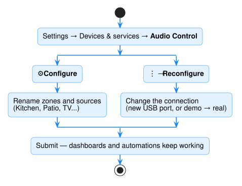
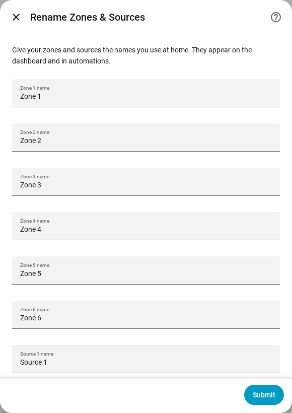

# Names and settings

You set everything up with clicks. There are no files to edit.

## Rename zones and sources

At first, the zones are called *Zone 1, Zone 2…* and the sources *Source 1,
Source 2…*. To give them real names:

1. Go to **Settings → Devices & services → Audio Control**.
2. Click the **gear icon** (Configure) next to your amplifier.
3. Type the new names, such as *Kitchen*, *Patio*, *TV*, and *Streamer*, and click
   **Submit**.

{ width="420" }

The new names appear on the zones and in each zone's source list.

!!! note "Amplifier with a password?"
    A few amplifiers, such as RTI, need a username and password. Enter them on the
    same screen. To keep the stored ones, leave the boxes empty.

## Change the connection

If you moved the adapter to another USB port, or you're switching from `demo` to the
real amplifier, you don't need to start over:

1. Go to **Settings → Devices & services → Audio Control**.
2. Click **⋮** next to your amplifier → **Reconfigure**.
3. Enter the new **Connection** and click **Submit**.

Your zones, names, dashboards, and automations stay as they were.

## Connection types

| You have | Enter in **Connection** |
|---|---|
| USB adapter on the Home Assistant machine | `/dev/serial/by-id/usb-...` ([how to find it](getting-started/install-audio-control.md#finding-the-connection)) |
| Amplifier or adapter on the network | `socket://192.168.1.50:4999` (its address and port) — see [Network connections](reference/network-transport.md) |
| Nothing yet; you're trying it out | `demo` |
