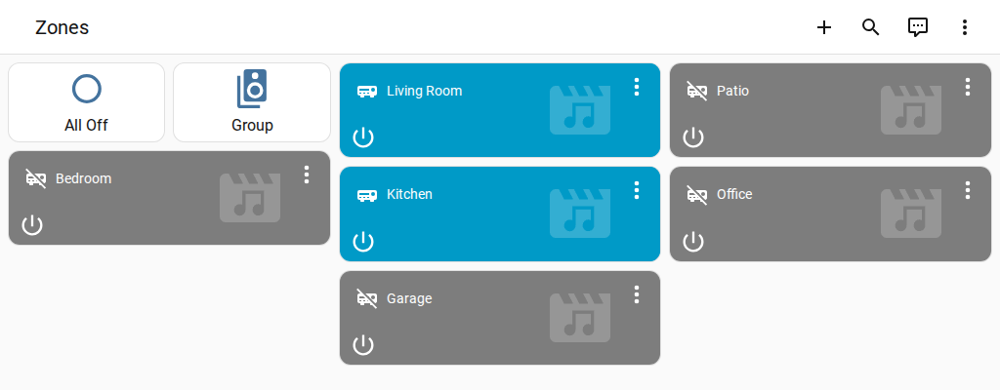
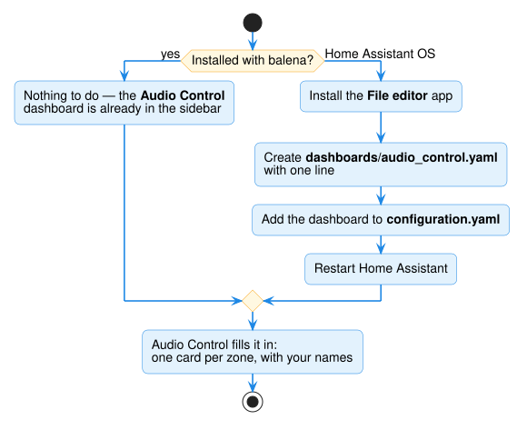

# Ready-made dashboard

Audio Control can build an **Audio Control** dashboard for you: one card per zone,
named after your zones, plus **All Off** and **Group** buttons. It keeps itself up to
date — add a zone or rename one and the dashboard follows.





## Installed with balena?

Nothing to do — it is already in the sidebar.

## Home Assistant OS

You switch it on once, by creating one file and adding a few lines to Home Assistant's
settings file. The **File editor** app lets you do that in the browser.

### 1. Install the File editor app

1. Go to **Settings → Apps** and open the **app store** (button at the bottom right).
2. Search for **File editor**, open it and click **Install**.
3. When it's installed, turn on **Show in sidebar**, then click **Start**.

### 2. Create the dashboard file

1. Open **File editor** from the sidebar.
2. Click the folder icon (top left) → **New folder**, and name it `dashboards`.
3. Open the `dashboards` folder → **New file**, and name it `audio_control.yaml`.
4. Put exactly this one line in it, then click **Save** (the red disk icon):

    ```yaml
    # audio_control:managed
    ```

That line tells Audio Control that it may fill in this file.

### 3. Add the dashboard to your settings

1. In File editor, open **`configuration.yaml`** (in the top folder).
2. Add this at the end, then **Save**:

    ```yaml
    lovelace:
      dashboards:
        audio-control:
          mode: yaml
          title: Audio Control
          icon: mdi:speaker-multiple
          show_in_sidebar: true
          filename: dashboards/audio_control.yaml
    ```

!!! warning "Already have a `lovelace:` line?"
    Then don't add a second one — add only the part from `dashboards:` down, under your
    existing `lovelace:` (or under its `dashboards:` if it has one).

### 4. Restart

**Settings → System → ⏻ (top right) → Restart Home Assistant.** After the restart,
**Audio Control** appears in the sidebar with all your zones.

## Make it your own

The dashboard is rebuilt each time Audio Control starts, so edits to it are replaced.
To keep your own version, open `dashboards/audio_control.yaml` and **delete its first
line** (`# audio_control:managed`). From then on Audio Control never touches it, and
you can change it freely — or copy its cards into a dashboard of your own.
