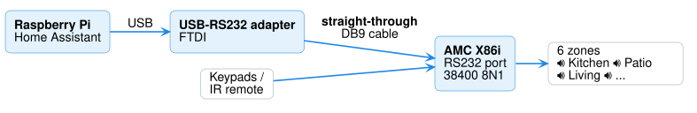
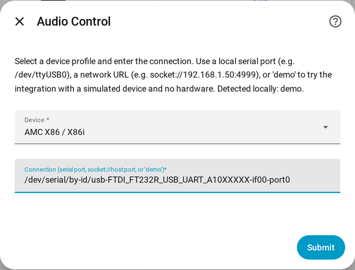
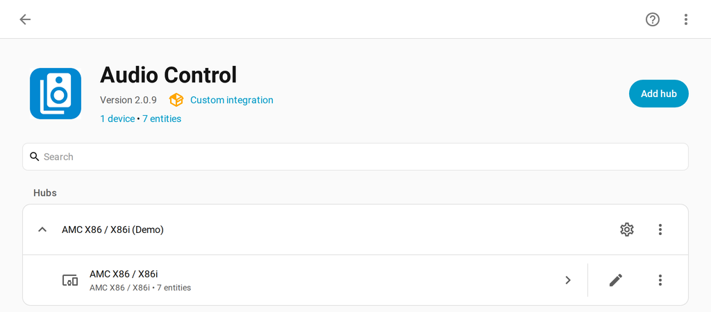
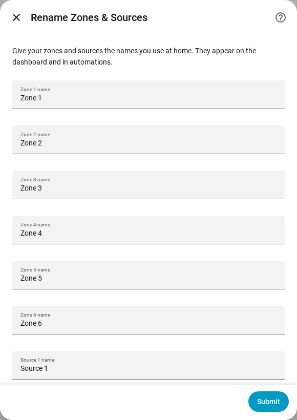
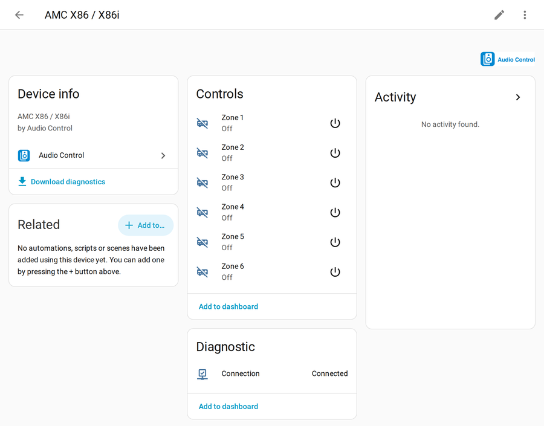
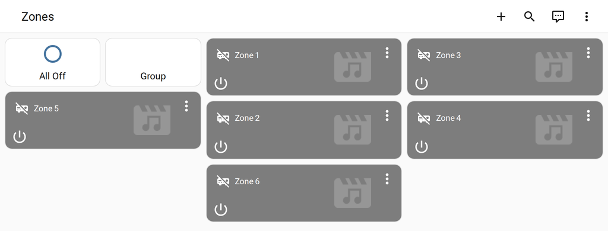

# Example: AMC X86i

A complete setup for the **AMC X86i** 6-zone / 8-source amplifier, from cable to
dashboard. The same steps apply to the AMC X86 and XO (pick their profile instead).

Everything on this page was verified against a real X86i over RS-232.

## What you need

| Part | For this example |
|---|---|
| Amplifier | **AMC X86i** with its RS-232 port (rear panel, item 8 in the AMC manual — a standard **DB9** connector; AMC lists RS-232 as an option on some units) |
| Home Assistant machine | **Raspberry Pi 4 or 5** (2 GB+ RAM), A2 microSD 32 GB+ or USB SSD, official power supply, Home Assistant OS |
| Adapter | **USB-to-RS232** (DB9 male, FTDI chip recommended) — not a USB-to-TTL adapter |
| Cable | **Straight-through** DB9 serial cable from the adapter to the X86i (tested; no null-modem adapter needed) |
| Software | Home Assistant with HACS and Audio Control installed ([steps 2–4](../getting-started/install-home-assistant.md)) |

Full details and alternatives: [Shopping list](../getting-started/prerequisites.md#shopping-list).

You don't need to set any serial settings — choosing *AMC X86 / X86i* takes care of them.

??? note "Serial settings (for reference)"
    38400 baud, 8 data bits, no parity, 1 stop bit, no flow control — from AMC's RS-232 manual.

## 1. Connect the cable



1. Plug the USB adapter into the Home Assistant machine.
2. Connect a **straight-through** DB9 serial cable from the adapter to the X86i's
   **RS232** port.
3. Power the X86i on.

## 2. Find the connection

Go to **Settings → Connectivity → Serial** and copy the adapter's name — the one that
starts with **`/dev/serial/by-id/`**, for example

`/dev/serial/by-id/usb-FTDI_FT232R_USB_UART_A10XXXXX-if00-port0`

*(Older Home Assistant: **Settings → System → Hardware → ⋮ → All hardware**, search
"serial". Docker users: see [Docker / Container installs](../advanced/docker.md).)*

## 3. Add the amplifier

**Settings → Devices & services → Add integration**, search **Audio Control**, then:

- **Device:** `AMC X86 / X86i`
- **Connection:** the path from step 2

{ width="480" }

Click **Submit**. Audio Control connects to the amplifier and creates:

- **6 zones** — each one a player with power, volume, mute and source
- **1 connection indicator** — shows whether the amplifier is answering



!!! note "No amplifier yet?"
    Enter `demo` as the connection to get the same entities with a simulated X86i.
    Later, open the device's **⋮ → Reconfigure** and enter the real port — nothing else
    changes.

## 4. Name your zones and sources

Click the **gear icon** next to the amplifier and replace *Zone 1…6* and *Source 1…8*
with real names (*Kitchen*, *Patio*, *Streamer*, *TV*…).

{ width="420" }

## 5. Use it

Each zone works like a smart speaker in Home Assistant — on dashboards, in the phone
app, with voice assistants and in automations.





Good to know about the X86i:

| Feature | How it behaves |
|---|---|
| **Volume** | Shown as a normal 0–100 % slider |
| **Keypads and remote** | Changes made there show up in Home Assistant too |
| **Bass / treble** | Levels **−8, −6, −4, 0, +4, +6, +8** (no ±2), and only while the zone is **on** ([how](../services.md)) |
| **All zones off** | One action turns every zone off ([how](../services.md)) |
| **Group mode** | Every room plays the same source ([how](../services.md)) |
| **Muted vs off** | Shown correctly |

Example automation — warmer sound in the kitchen at dinner:

```yaml
- alias: Kitchen dinner EQ
  triggers:
    - trigger: time
      at: "18:30:00"
  conditions:
    - condition: state
      entity_id: media_player.kitchen   # your zone 1 entity
      state: "on"                       # tone needs the zone on
  actions:
    - action: audio_control.set_bass
      target:
        entity_id: media_player.kitchen
      data:
        level: 4
```

## If it doesn't work

| Symptom | Check |
|---|---|
| Connection shows **Disconnected** | Adapter path, cable seated, amplifier powered. The X86i needs a **straight-through** cable — a null-modem cable or adapter will not work |
| Connected, but zones never change | Wrong model selected in *Device*, or another program is using the adapter |
| Older X86 units | Handled automatically |

More in [Troubleshooting](../troubleshooting.md).
