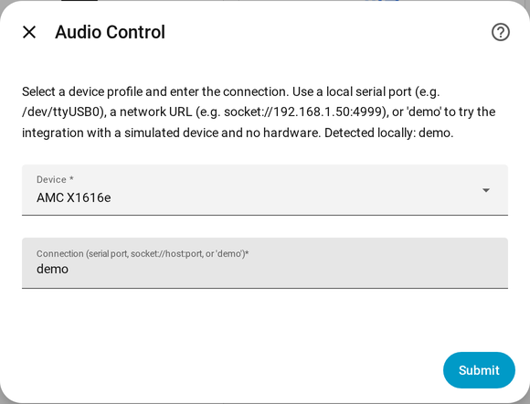

# 4. Install Audio Control

Audio Control is in the **HACS default store** — no custom repository is needed.

1. Open **HACS** from the sidebar and search for **Audio Control**
   (or use the button above).
2. Open it and click **Download**, then confirm.
3. **Restart Home Assistant** (Settings → System → ⋮ → Restart).
4. Go to **Settings → Devices & services → Add integration** and search
   **Audio Control**.

The setup form opens:

{ width="480" }

| Field | What to enter |
|---|---|
| **Device** | Your model's profile, or *>> Custom Device (define via UI)* |
| **Connection** | Serial port (`/dev/serial/by-id/...`), `socket://host:port`, `rfc2217://host:port`, or `demo` |

!!! tip "Try `demo` first"
    Entering `demo` as the connection simulates the device. You get the full set of zone
    entities and can build dashboards and automations before the hardware is wired up.
    Switch to the real port later with **Reconfigure** — entities and automations are
    kept.

Not sure what to enter? The [AMC X86i example](../examples/amc-x86i.md) walks through
a complete setup.

## Updating

HACS shows updates when a new release is published. Update from **HACS → Audio
Control → Update**, then restart Home Assistant.

## Manual install (without HACS)

Copy `custom_components/audio_control/` from the
[latest release](https://github.com/mcjelcom/ha-audio-control/releases/latest) into
your Home Assistant `config/custom_components/` directory and restart. You will not
get update notifications this way.
