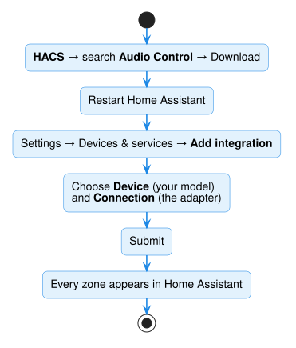

# 4. Install Audio Control

## Download it from HACS

1. Click **HACS** in the Home Assistant sidebar.
2. Search for **Audio Control** and open it.
3. Click **Download**, then **Download** again to confirm.
4. **Restart** Home Assistant: **Settings → System → ⏻ (top right) → Restart Home Assistant**.

To jump straight there, click this button:

## Add your amplifier

1. Go to **Settings**, then **Devices & services**.

    { width="560" }

2. Click **Add integration** (bottom right). Type **Audio Control** and click it.

    { width="420" }

3. Fill in the form:

    { width="420" }

    - **Device**: choose your amplifier's model from the list.
    - **Connection**: the USB adapter. Home Assistant usually lists it under
      *Detected locally*. It looks like `/dev/serial/by-id/usb-FTDI_...`. See
      [Finding the connection](#finding-the-connection).

4. Click **Submit**.

Each zone now appears in Home Assistant. Next, give the zones proper names: see
[Names and settings](../configuration.md).

!!! tip "Try it without the amplifier"
    Type **`demo`** in **Connection** to get a pretend amplifier. Everything works the
    same, so you can set up your dashboard first. Later,
    [change the connection](../configuration.md#change-the-connection) to the real one.

## Finding the connection

Go to **Settings → Connectivity → Serial**. It lists the USB adapters that Home
Assistant detects. Copy the one that starts with **`/dev/serial/by-id/`**.

{ width="560" }

*(Older Home Assistant versions: **Settings → System → Hardware → ⋮ → All hardware**,
then search for "serial".)*

Nothing listed? See [The adapter isn't listed](../troubleshooting.md#the-adapter-isnt-listed).

## Updates

When a new version comes out, HACS shows an **update** for Audio Control. Click
**Update**, then restart Home Assistant.
