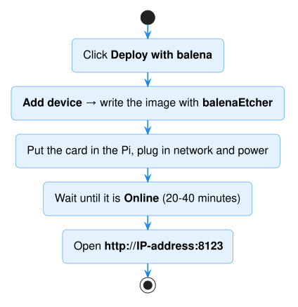
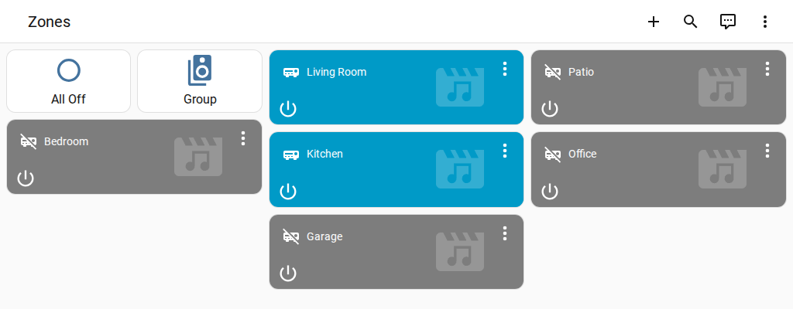

# Install with balena (preview)

*Not sure this is for you? See [Choose how to install](choose-install.md) — for one
Raspberry Pi at home, [Home Assistant OS](install-home-assistant.md) is simpler.*

This puts Home Assistant **with Audio Control already installed** — and a ready-made
**Audio Control dashboard** — on your Raspberry Pi,
managed from the [balenaCloud](https://www.balena.io/cloud) dashboard. You skip the
HACS and Audio Control steps.

## You'll need

- Everything on the [shopping list](prerequisites.md) — a **Raspberry Pi 4 or 5**
  (a Raspberry Pi 3 works too, but slowly), memory card, power supply, adapter and cable
- A free **balenaCloud** account — you can create it in step 1
- **balenaEtcher** on your computer, to write the memory card
  ([download](https://etcher.balena.io/))

## 1. Create your fleet

Click the button:

Sign in (or sign up), give the fleet a name — for example *audio-control* — choose your
**Raspberry Pi model** as the device type, and click **Create and deploy**. balena now
builds Home Assistant with Audio Control for that fleet; it takes a couple of minutes.

## 2. Prepare the memory card

1. In your new fleet, click **Add device**.
2. Choose **Ethernet only** (recommended), or **Wi-Fi + Ethernet** and type your Wi-Fi
   name and password.
3. Click **Download balenaOS**, then open the file in **balenaEtcher** and write it to
   the memory card. (Or click **Flash** to do both in one go.)

## 3. Start the Raspberry Pi

1. Put the card in the Raspberry Pi. Connect the network cable, the USB adapter, and
   the power supply.
2. After a few minutes the device appears in the fleet as **Online**, and starts
   downloading Home Assistant. That download is large — allow **20–40 minutes**.
3. When the device page shows the **homeassistant** service as **Running**, note the
   device's **IP address** on that page.

## 4. Open Home Assistant

Open **http://&lt;IP address&gt;:8123** in your web browser (for example
`http://192.168.1.50:8123`), create your account and follow the welcome screens.

Then add your amplifier exactly as in the main guide —
[Add your amplifier](install-audio-control.md#add-your-amplifier). There is nothing to
download first: Audio Control is already there.

## Your Audio Control dashboard

The template adds an **Audio Control** dashboard to the sidebar. As soon as you add your
amplifier it fills in by itself — one card per zone, with your zone names, plus
**All Off** and **Group** buttons. Rename a zone and the dashboard follows.

Want to change it yourself? See [Make it your own](../dashboard.md#make-it-your-own).

Ready-made **automations** come with it too: **Settings → Automations & scenes →
Blueprints** (all zones off at a time, turn a zone on at a set time, volume limit, …).
They do nothing until you create an automation from one.

## Matter (optional)

The template includes **Matter Hub**, switched **off**. To share your zones with Google
Home, Alexa or SmartThings over Matter ([what works](../matter.md)), add these **device
variables** in the balena dashboard (your device → **Variables** → **Add**, service
`matter-hub`):

| Variable | Value |
|---|---|
| `HAAC_MATTER` | `1` |
| `HAMH_HOME_ASSISTANT_ACCESS_TOKEN` | a long-lived token — Home Assistant → your profile (bottom left) → **Security** → **Create token** |
| `HAMH_HTTP_AUTH_USERNAME` | a username of your choice |
| `HAMH_HTTP_AUTH_PASSWORD` | a password, **at least 12 characters** |

Then open **http://&lt;IP address&gt;:8482**, log in, and continue at
[Create a bridge](../matter.md#2-create-a-bridge-for-your-zones). Until all four are set,
Matter Hub stays off and opens nothing on your network.

## Updates

Home Assistant and Audio Control are updated together, by new releases of the
[template](https://github.com/mcjelcom/haac-balena/releases). To update, open your
fleet in the balena dashboard and deploy the new release (the same **Deploy with balena**
button, or **balena push** if you use the balena command line).

!!! warning "Don't install Audio Control from HACS on a balena device"
    The built-in copy replaces it every time the device starts. You can still use HACS
    for other integrations.

## Good to know

- Home Assistant is reachable on your **home network only**, protected by its own login.
  The template opens nothing else (no SSH, no file editor).
- There are no **Apps** (add-ons) on balena. Use the balena dashboard for logs, a
  terminal and restarts.
- Something not working? See [Help & troubleshooting](../troubleshooting.md), and
  check the **homeassistant** logs on the device page.
