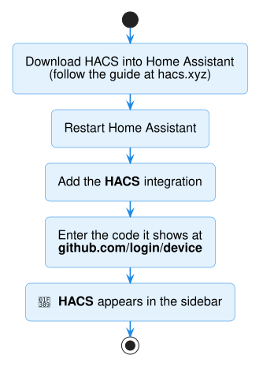

# 3. Install HACS

*Already have HACS in your Home Assistant sidebar? Skip to
[4. Install Audio Control](install-audio-control.md).*

**HACS** is a free "app store" for things the Home Assistant community makes, including
Audio Control.

Follow the illustrated HACS guide:

**➜ [HACS installation guide](https://hacs.xyz/docs/use/)**

In short:

1. **Download HACS** into Home Assistant as the guide describes for
   *Home Assistant OS*. (Home Assistant calls extras like this **Apps**, under
   **Settings → Apps**. Older versions called them *add-ons*.)
2. **Restart** Home Assistant: **Settings → System → ⏻ (top right) → Restart Home Assistant**.
3. Go to **Settings → Devices & services → Add integration**. Search for **HACS** and
   tick the boxes.
4. HACS shows a short **code**. Open [github.com/login/device](https://github.com/login/device),
   type the code, and click **Authorize**.

**HACS** now appears in the Home Assistant sidebar.

!!! info "Is this safe?"
    HACS reads only public projects from GitHub. Audio Control never connects to the
    internet. It talks only to your amplifier.

---

**Next:** [4. Install Audio Control](install-audio-control.md)
