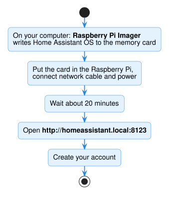

# 2. Install Home Assistant

*Already have Home Assistant? Skip to [3. Install HACS](install-hacs.md).*

Follow Home Assistant's illustrated guide exactly:

**➜ [Install Home Assistant on a Raspberry Pi](https://www.home-assistant.io/installation/raspberrypi)**

In short:

1. On your computer, use the **Raspberry Pi Imager** app to put **Home Assistant OS**
   on the memory card. Pick the image for your model (Pi 5, Pi 4, or Pi 3).
2. Put the card in the Raspberry Pi. Connect the network cable and the power supply.
3. Wait about 20 minutes. Then open **http://homeassistant.local:8123** in your web
   browser.
4. Create your account and follow the welcome screens.

When you see the Home Assistant dashboard, go to the next step.

!!! note "Using Docker instead?"
    If you run Home Assistant in Docker (also called *Container*), see
    [Docker / Container installs](../advanced/docker.md). You need one extra setting so
    Home Assistant can see the USB adapter.

---

**Next:** [3. Install HACS](install-hacs.md)
