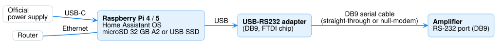

# 1. What you need

## Shopping list

| Item | What to get | Why |
|---|---|---|
| **Raspberry Pi** | **Raspberry Pi 5** or **Raspberry Pi 4**, with **2 GB of memory or more** | Runs Home Assistant |
| **Memory card** | microSD card, **32 GB or larger**, marked **A2** | Holds Home Assistant. (A USB SSD drive is even better — it lasts longer) |
| **Power supply** | The **official Raspberry Pi power supply** for your model (Pi 5: 27 W, Pi 4: 15 W) | A phone charger is often too weak and causes random problems |
| **USB-to-RS232 adapter** | A USB to **RS232 (DB9)** adapter — one with an **FTDI** chip is the safest choice | Lets the Raspberry Pi talk to the amplifier |
| **Serial cable** | A **DB9 serial cable**, long enough to reach the amplifier | Connects the adapter to the amplifier |
| **Network cable** *(recommended)* | An Ethernet cable to your router | More reliable than Wi-Fi |

Already have Home Assistant running on another computer? You only need the **adapter**
and the **cable**.

!!! warning "Buy RS232 — not TTL"
    Shops also sell "USB to TTL" adapters with loose pins for electronics projects.
    They look similar but **won't work** with an amplifier. Look for a **DB9 plug**
    (9 pins in two rows) and the word **RS232**.

## Which cable?

Serial cables come in two kinds: **straight-through** and **null-modem**. Your
amplifier's manual usually says which one it needs.

- **AMC X86i:** straight-through (tested).
- **Not sure?** Start with straight-through. If the amplifier doesn't respond, add a
  small **null-modem adapter** between the cable and the amplifier. Trying the wrong
  one does no harm.

## Your amplifier

Check that it has an **RS232** port (usually a 9-pin connector on the back) and that
it's on the [list of supported models](../index.md#supported-amplifiers).

!!! tip "Amplifier far from the Raspberry Pi?"
    Serial cables work up to about 15 m (50 ft). For longer distances you can use a
    small network adapter next to the amplifier instead — see
    [Network connections](../reference/network-transport.md).

## A GitHub account

HACS (step 3) signs in with a free [GitHub](https://github.com/signup) account.
Create one now if you don't have it.

---

**Next:** [2. Install Home Assistant](install-home-assistant.md) — or first see
[Choose how to install](choose-install.md) if you want to manage the Pi remotely.
