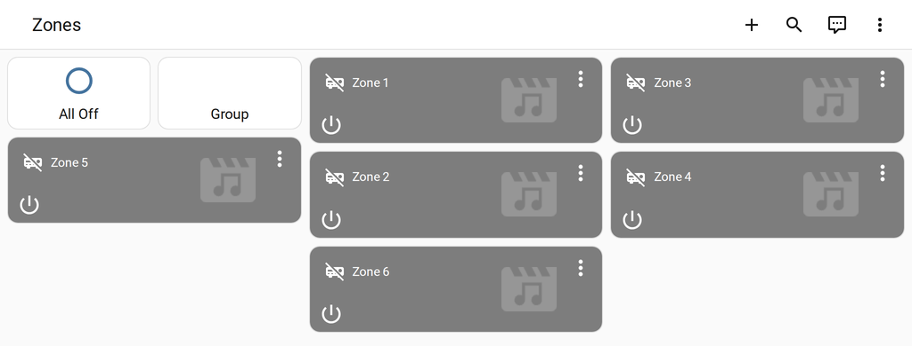
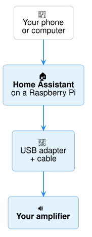

# Audio Control for Home Assistant

Turn your **multi-room amplifier** into something you can control from your phone,
your dashboard and your automations — switch zones on and off, change the volume and
the music source, all from Home Assistant.

[Quickstart →](quickstart.md){ .md-button .md-button--primary }
[Full step-by-step guide](getting-started/prerequisites.md){ .md-button }

## How it works

Home Assistant talks to your amplifier through its **RS-232 control port** (a small
9-pin connector on the back). Every zone becomes its own player in Home Assistant.

## What you can do

- **Each zone on and off**, **volume**, **mute** and the **source** — from the
  dashboard, the Home Assistant phone app, or by voice
  ([Using your zones](using-zones.md))
- **Bass and treble** on amplifiers that have them, **all zones off** with one tap, and
  **group mode** (every room plays the same thing)
  ([Automations & extra controls](services.md))
- **Siri, Google and Alexa** — share your zones with Apple Home, Google Home and Alexa
  ([how](smart-home.md)), or locally over **Matter** ([partial](matter.md))
- **Your own names** for zones and sources — "Kitchen", "Radio"
  ([Names & settings](configuration.md))
- **Stays in sync** — changes made on the amplifier's own keypads show up in Home
  Assistant too (on amplifiers that report them), and a **connection status** shows
  whether the amplifier is answering
- **Phone app** — the free Home Assistant app for iPhone and Android, with home-screen
  widgets ([Phone app](phone-app.md))
- **Ready-made dashboard** — one card per zone, built and kept up to date for you
  ([Ready-made dashboard](dashboard.md))
- **Automations** — e.g. turn everything off at midnight, or start the patio speakers
  when you get home — with six ready-made ones to import in one click
  ([list](services.md#ready-made-automations-blueprints))
- **RS232 or network** — a USB-RS232 adapter, a serial-to-Ethernet gateway, or the
  amplifier's own IP control ([Network connections](reference/network-transport.md))
- **Try it first** — `demo` mode gives you a pretend amplifier to set everything up
  before it's connected
- **Amplifier not listed?** Describe it in a few steps in the setup screen, or with a
  small file ([Adding a device](reference/adding-a-device.md))
- **Local and private** — Audio Control only talks to your amplifier, never to the
  internet
- **Two ways to install** — Home Assistant OS (recommended), or balena for managing
  Raspberry Pis remotely ([Choose how to install](getting-started/choose-install.md))

## Works with — apps, assistants and Matter

| Where you control it | How | On/off | Volume | Mute | Source | Bass / treble | All off / group | Checked |
|---|---|---|---|---|---|---|---|---|
| **Home Assistant** dashboard & [phone app](phone-app.md) | built in | ✅ | ✅ | ✅ | ✅ | ✅ ¹ | ✅ | ✅ on a real AMC X86i |
| **Automations** & [blueprints](services.md#ready-made-automations-blueprints) | built in | ✅ | ✅ | ✅ | ✅ | ✅ | ✅ | ✅ on a real AMC X86i |
| **Apple Home / Siri** | [HomeKit Bridge](smart-home.md#apple-home-siri) — free, local | ✅ | ◐ ² | ✅ | ✅ | — | — | ◐ in Home Assistant ³ |
| **Google Home** | [Home Assistant Cloud](smart-home.md#google-home-and-alexa) — subscription | ✅ | ✅ | ✅ | ◐ ⁴ | — | — | ❔ HA's docs |
| **Google Home** | [Matter](matter.md) — free, local, needs a Google hub | ✅ | ✅ | — | ◐ ⁵ | — | — | ✅ in the Google Home app |
| **Alexa** | [Home Assistant Cloud](smart-home.md#google-home-and-alexa) — subscription | ✅ | ✅ | ✅ | ◐ ⁴ | — | — | ❔ HA's docs |
| **Alexa** | [Matter](matter.md#alexa-add-a-music-switch-per-zone) — free, local, needs a Matter Echo | ✅ ⁶ | — | — | — | — | — | ◐ Matter test controller |
| **SmartThings / Aqara** | [Matter](matter.md) — free, local | ✅ | ✅ | — | ◐ ⁵ | — | — | ◐ Matter test controller |

✅ works · ◐ partly · — not available · ❔ expected, not yet tested by us

1. On amplifiers with tone control, through the [bass and treble actions](services.md).
2. Volume up/down from the Control Center remote; Apple offers no slider for TV-style accessories.
3. What Home Assistant hands to Apple was checked; not yet on an iPhone.
4. Depends on how the assistant classes the device.
5. The zone's sources are sent over Matter by name (tested); whether the app shows them varies.
6. Through one "Music" switch per zone — Alexa doesn't accept Matter speakers.

## Supported amplifiers

**80 models from 11 brands** — including:

| Brand | Models | Examples |
|---|---|---|
| [AMC](supported-models.md#amc) | 13 | X1616e, X86, X86i, DR-X86T… |
| [Marantz](supported-models.md#marantz) | 5 | PM7000N, SR5015, SR6015, SR7015… |
| [Monoprice](supported-models.md#monoprice) | 8 | 31028, 10761, 39261, 44519… |
| [NAD](supported-models.md#nad) | 4 | C368, C388, C658, M10 |
| [Oppo](supported-models.md#oppo) | 4 | UDP-203, UDP-205, BDP-103, BDP-105 |
| [Rotel](supported-models.md#rotel) | 13 | Michi M8, Michi S5, RA-1572, RA-1592… |
| [RTI](supported-models.md#rti) | 5 | AD-4x, AD-8x, AD-46-100, AD-810-100… |
| [Russound](supported-models.md#russound) | 10 | CAV6.6, CAA66, CAS44, CAS66… |
| [SpeakerCraft](supported-models.md#speakercraft) | 3 | MZC-64, MZC-66, MZC-88 |
| [Xantech](supported-models.md#xantech) | 10 | MRC-88, MRC-88m, MRAUDIO8x8, MX88vi… |
| [Yamaha](supported-models.md#yamaha) | 5 | RX-A1080, RX-A2080, RX-A3080, RX-V685… |

**[See every supported model →](supported-models.md)**
