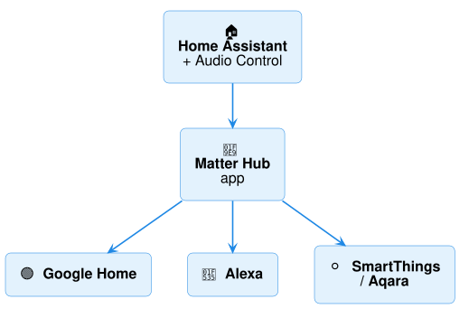
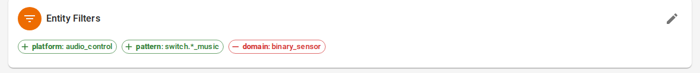
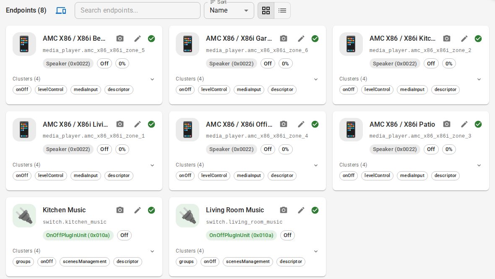

# Matter (partial)

Matter lets **Google Home**, **Alexa**, **SmartThings** and **Aqara** control your zones
**locally and for free** — no cloud subscription. Support is partial: Matter has no
amplifier device type yet, so each zone appears as a simple **speaker**.

## What works where

| | Google Home | Alexa | SmartThings / Aqara | Apple Home |
|---|---|---|---|---|
| Zone on/off | ✅ | ✅ through a "Music" switch ([below](#alexa-add-a-music-switch-per-zone)) | ✅ | use [HomeKit Bridge](smart-home.md#apple-home-siri) instead |
| Volume | ✅ | — | ✅ | |
| Source | sent, but the app may not show it | — | sent, the app may not show it | |
| Mute, bass/treble, group | — | — | — | |

Each zone is shared as a Matter **Speaker** with power, volume and its list of sources.
Alexa doesn't accept Matter speakers, so for Alexa you add one **"Music" switch** per zone
— Alexa sees it as a plug ("Alexa, turn on the Kitchen Music").

!!! info "Tested so far"
    Checked on a demo Home Assistant with a Matter test controller (matter.js): pairing,
    zone on/off, volume and choosing a source by name, and the Alexa-style switch — all
    reached the amplifier. Pairing with the Google Home and Alexa apps themselves is not
    yet tested. [Tell us](https://github.com/mcjelcom/ha-audio-control/issues) how it goes.

## What you need

- **A Matter hub from your app's maker** on your home network: for Google, a Nest speaker
  or display, Nest Wifi or Google TV Streamer; for Alexa, an Echo that supports Matter.
  The app alone isn't enough.
- **Nothing extra on the Raspberry Pi.** Matter here runs over your normal network
  (Ethernet is best). A Thread USB stick is only for Thread gadgets like sensors — not
  needed for Audio Control.
- **Home Assistant OS** (for the Matter Hub app). On balena, Matter Hub isn't included
  yet.

## 1. Install the Matter Hub app

[Home Assistant Matter Hub](https://github.com/RiDDiX/home-assistant-matter-hub) is a free,
community-made app that shares Home Assistant devices over Matter.

1. **Settings → Apps → app store** (bottom right) → **⋮** (top right) → **Repositories**.
2. Add `https://github.com/riddix/home-assistant-addons` and click **Add**.
3. Refresh, find **Home-Assistant-Matter-Hub**, **Install**, then **Start**, and turn on
   **Show in sidebar**.

## 2. Create a bridge for your zones

Open **Matter Hub** from the sidebar and create a bridge:

- **Name:** e.g. *Audio Control*. **Port:** keep **5540** — Alexa only finds bridges on 5540.
- **Include:** *platform* `audio_control` (all your zones). For Alexa also *pattern*
  `switch.*_music` (the switches below).
- **Exclude:** *domain* `binary_sensor` (the connection status isn't something to control).
- Turn on **Prefer entity registry name**, so zones are called *Living Room* rather than
  *AMC X86 / X86i Living Room* — shorter to say. Do this **before pairing**: once an app
  has paired, the bridge keeps the names that app already knows.

The bridge then lists every zone as a **Speaker** (and each "Music" switch as a **Plug**):

## Alexa: add a "Music" switch per zone

1. **Settings → Devices & services → Helpers → Create helper → Template → Switch.**
2. **Name:** e.g. `Kitchen Music`.
3. **Value template:** `{{ is_state('media_player.YOUR_ZONE', 'on') }}` — the zone's
   entity ID is on its settings page (⚙).
4. **Actions on turn on:** *Media player: Turn on* → your zone. **Actions on turn off:**
   *Media player: Turn off* → your zone. **Submit.**

Repeat for each zone you want Alexa to switch.

## 3. Pair with your app

On the bridge page, Matter Hub shows a **QR code** and a **manual code**.

- **Google Home:** **+ → Device → Matter-enabled device** → scan the code. Google warns
  that it's an *uncertified device* — continue. (Optional: register it in the
  [Google Home Developer Console](https://console.home.google.com/projects/) with
  vendor ID `0xFFF1` and product ID `0x8000` to drop the warning.)
- **Alexa:** **+ → Device → Other → Matter** → scan the code.
- **SmartThings / Aqara:** add a Matter device and scan the code.

One bridge can be paired with several apps — use **Add Another Controller** on the bridge
page for the second one.

!!! tip "Devices show as offline?"
    Matter needs IPv6 and mDNS on your home network. If zones go "unavailable", see
    Matter Hub's [troubleshooting guide](https://riddix.github.io/home-assistant-matter-hub/).
