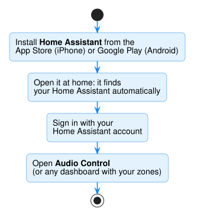
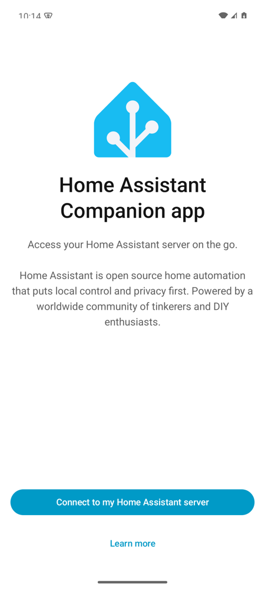
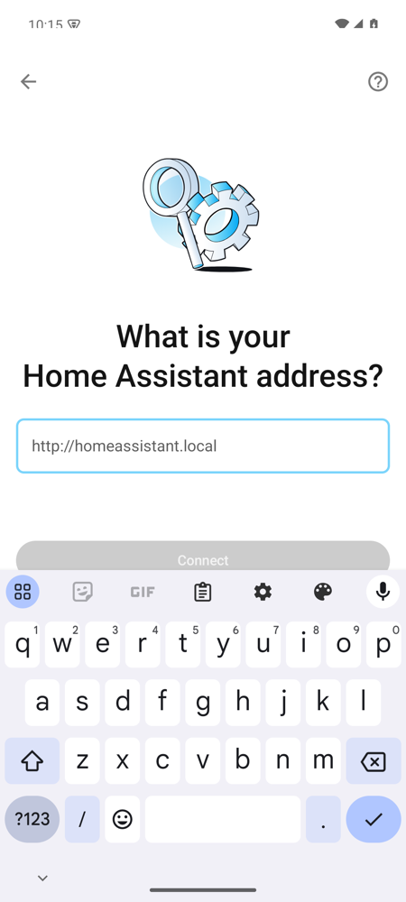
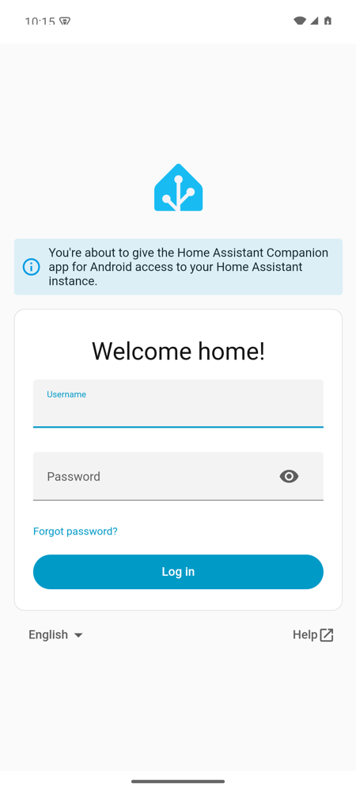
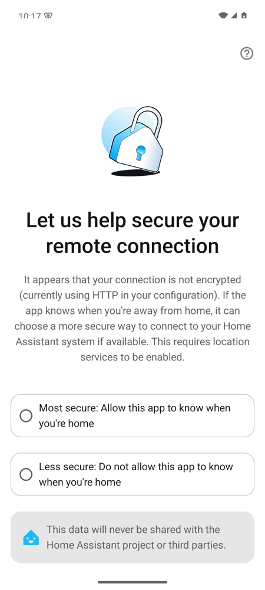
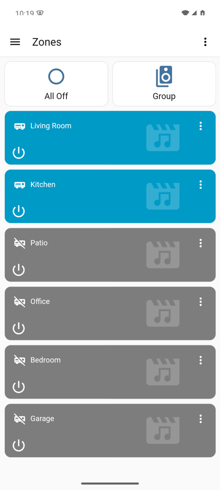
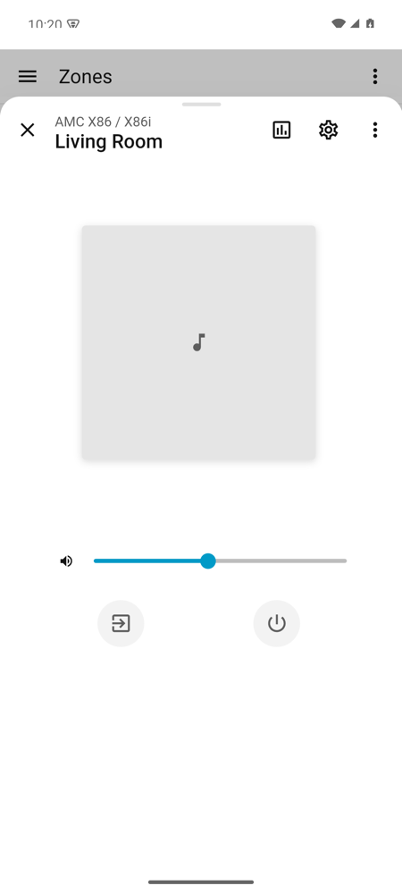
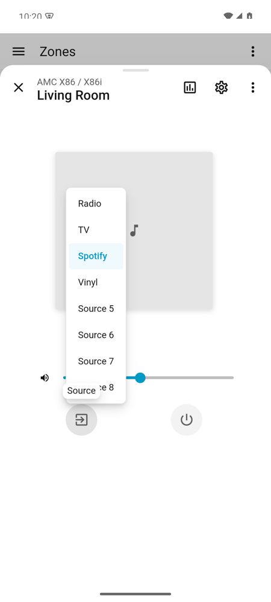

# Phone app

The free **Home Assistant** phone app gives you your dashboards plus home-screen widgets.

## Install and connect

1. Install **Home Assistant** from the
   [App Store](https://apps.apple.com/app/home-assistant/id1099568401) (iPhone, iPad)
   or [Google Play](https://play.google.com/store/apps/details?id=io.homeassistant.companion.android)
   (Android).
2. **On your home Wi-Fi**, open it, tap **Connect to my Home Assistant server**, and
   tap your Home Assistant.
3. Not listed? Tap **Enter address manually**, type `http://homeassistant.local:8123`
   (balena: `http://<IP address>:8123`, from the balena dashboard's device page), and
   tap **Connect**.
4. **Log in** with your Home Assistant username and password.

{ width="220" }
{ width="220" }
{ width="220" }

Then:

- **Name this device:** enter any name (e.g. *John's phone*) and tap **Save**.
- **Local by default:** tap **Got it**.
- **Secure your remote connection:** choose **Most secure: Allow this app to know when
  you're home** and allow location **While using the app**. On Android, also allow
  **Nearby devices** (to read your Wi-Fi name). This data stays with you.
- **Notifications:** optional.

{ width="220" }

## Your zones in the app

From the menu (☰, top left), tap **Audio Control** (see
[Ready-made dashboard](dashboard.md)) or another dashboard with your zones (see
[Put zones on a dashboard](using-zones.md#put-zones-on-a-dashboard)). Tap a zone's name
for **volume**, **source**, and **power**.

{ width="220" }
{ width="220" }
{ width="220" }

**Widgets:** for one-tap on/off, long-press the home screen, tap
**widgets → Home Assistant**, and pick a zone.

*Screenshots: Android app (2026.11), demo amplifier. The iPhone app is similar.*

## Away from home

Away from home, you need remote access. Easiest is **Home Assistant Cloud**
(**Settings → Home Assistant Cloud**), a paid subscription that also adds Google Home
and Alexa (see [Apple Home, Google Home, and Alexa](smart-home.md)). Otherwise, see
Home Assistant's [remote access guide](https://www.home-assistant.io/docs/configuration/remote/).

!!! tip "Use Siri or the Home app instead?"
    HomeKit Bridge puts your zones in Apple's **Home** app and Siri. See
    [Apple Home](smart-home.md#apple-home-siri).
