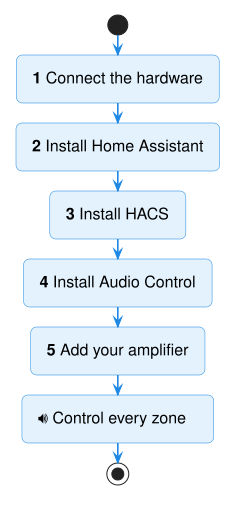
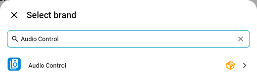
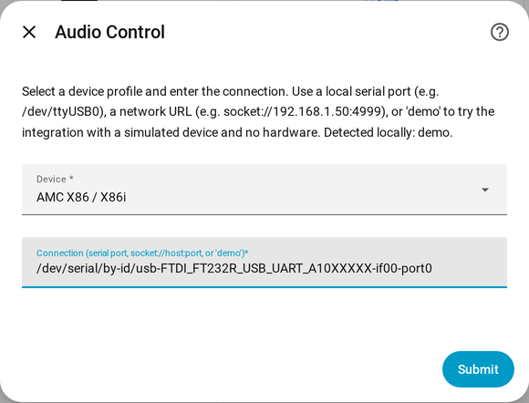
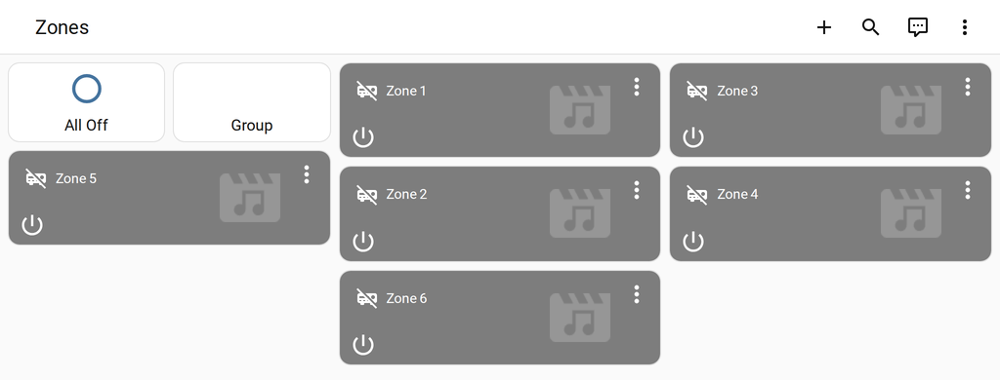

# Quickstart

Set up Audio Control in five steps, each linked to a detailed guide.

!!! abstract "You'll need"
    - Your amplifier, such as an **AMC X86i**
    - A **Raspberry Pi 4 or 5** with its official power supply
    - A **USB-to-RS232 adapter** and a **serial cable** (DB9)
    - About **1 hour**

## Step 1 — Connect the hardware

Plug the USB adapter into the Raspberry Pi, and the serial cable into the amplifier's
**RS232** port.

[What to buy →](getting-started/prerequisites.md)

## Step 2 — Install Home Assistant

Install **Home Assistant OS** on the Raspberry Pi and open it in your browser.

[Install Home Assistant →](getting-started/install-home-assistant.md)

*To manage the Pi remotely instead, see
[Choose how to install](getting-started/choose-install.md).*

## Step 3 — Install HACS

HACS is a free community "app store" that provides Audio Control.

[Install HACS →](getting-started/install-hacs.md)

## Step 4 — Install Audio Control

In **HACS**, search for **Audio Control**, click **Download**, and **restart** Home
Assistant.

[Install Audio Control →](getting-started/install-audio-control.md)

## Step 5 — Add your amplifier

1. Go to **Settings → Devices & services → Add integration**.
2. Search for **Audio Control** and click it.

    { width="420" }

3. In **Device**, choose your amplifier. In **Connection**, pick its port.

    { width="420" }

4. Click **Submit**.

Each zone now appears, ready to switch on, turn up, and change source.

!!! tip "No amplifier connected yet?"
    Type `demo` in **Connection** to try a pretend amplifier.

**Next:** [rename your zones and sources](configuration.md), or see the full
[AMC X86i example](examples/amc-x86i.md).
