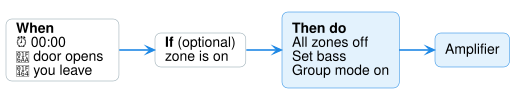

# Automations & extra controls

Besides the normal player controls, Audio Control adds a few **actions** you can use in
automations, scripts and buttons.



| Action | What it does |
|---|---|
| **Set bass** | Change a zone's bass (0 = flat) |
| **Set treble** | Change a zone's treble (0 = flat) |
| **All zones off** | Turn every zone off at once |
| **Group mode on** | Make every zone play the same source |
| **Group mode off** | Let each zone play its own source again |

!!! info "Not every amplifier has these"
    They only work on amplifiers that support them. **Bass and treble** levels depend
    on the model — the AMC X86i, for example, takes −8, −6, −4, 0, +4, +6, +8, and only
    while the zone is **on**. If a value isn't allowed, Home Assistant tells you which
    ones are.

## Ready-made automations (blueprints)

Fill-in-the-blanks automations for Audio Control. Click **Import blueprint**, then in
Home Assistant **Preview** → **Import**. To use one: **Settings → Automations & scenes →
Blueprints**, click it, pick your zones and times, and **Save**. Imported blueprints do
nothing until you create an automation from them.

| Automation | What it does | |
|---|---|---|
| **All zones off at a time** | Turn every zone off at a set time, optionally only on some days | [](https://my.home-assistant.io/redirect/blueprint_import/?blueprint_url=https%3A%2F%2Fgithub.com%2Fmcjelcom%2Fha-audio-control%2Fblob%2Fmain%2Fblueprints%2Fautomation%2Faudio_control%2Fall_zones_off_at_time.yaml) |
| **Scheduled zone on** | Turn a zone on at a set time with a chosen source and volume | [](https://my.home-assistant.io/redirect/blueprint_import/?blueprint_url=https%3A%2F%2Fgithub.com%2Fmcjelcom%2Fha-audio-control%2Fblob%2Fmain%2Fblueprints%2Fautomation%2Faudio_control%2Fscheduled_zone_on.yaml) |
| **Auto off when forgotten** | Turn a zone off after it has been on for a while | [](https://my.home-assistant.io/redirect/blueprint_import/?blueprint_url=https%3A%2F%2Fgithub.com%2Fmcjelcom%2Fha-audio-control%2Fblob%2Fmain%2Fblueprints%2Fautomation%2Faudio_control%2Fzone_auto_off_when_idle.yaml) |
| **Volume limiter** | Pull a zone's volume back down if it goes above a limit — protects speakers | [](https://my.home-assistant.io/redirect/blueprint_import/?blueprint_url=https%3A%2F%2Fgithub.com%2Fmcjelcom%2Fha-audio-control%2Fblob%2Fmain%2Fblueprints%2Fautomation%2Faudio_control%2Fvolume_limiter.yaml) |
| **Group mode switch** | Turn whole-house group mode on and off from any toggle or schedule | [](https://my.home-assistant.io/redirect/blueprint_import/?blueprint_url=https%3A%2F%2Fgithub.com%2Fmcjelcom%2Fha-audio-control%2Fblob%2Fmain%2Fblueprints%2Fautomation%2Faudio_control%2Fgroup_mode_toggle.yaml) |
| **Tone preset per source** | Set bass/treble when a zone switches to a source, and restore it after | [](https://my.home-assistant.io/redirect/blueprint_import/?blueprint_url=https%3A%2F%2Fgithub.com%2Fmcjelcom%2Fha-audio-control%2Fblob%2Fmain%2Fblueprints%2Fautomation%2Faudio_control%2Ftone_preset_on_source.yaml) |

*balena installs already have these — look under **Blueprints**.*

## Use them in an automation

1. **Settings → Automations & scenes → Create automation → Create new automation**.
2. Add a **trigger** — for example *Time: 00:00*.
3. Under **Then do**, click **Add action**, search **Audio Control**, and choose an
   action — for example **All zones off**.
4. **Save**.

## Examples

Prefer to copy and paste? In the automation editor choose **⋮ → Edit in YAML** and
paste one of these.

**Turn everything off at midnight**

```yaml
triggers:
  - trigger: time
    at: "00:00:00"
actions:
  - action: audio_control.all_zones_off
```

**Warmer sound in the kitchen at dinner time**

```yaml
triggers:
  - trigger: time
    at: "18:30:00"
conditions:
  - condition: state
    entity_id: media_player.kitchen   # your zone
    state: "on"
actions:
  - action: audio_control.set_bass
    target:
      entity_id: media_player.kitchen
    data:
      level: 4
```

**Party mode — every room plays source 3**

```yaml
actions:
  - action: audio_control.group_mode_on
    data:
      source: 3
```

??? note "Details for advanced users"
    | Action | Target | Notes |
    |---|---|---|
    | `audio_control.set_bass` / `set_treble` | zones, devices, areas, floors, labels | `level` −12…+12; the device profile decides which levels are valid (default even −8…+8). Every valid zone is changed, then one error reports any that couldn't be |
    | `audio_control.all_zones_off` | none — **all** Audio Control amplifiers that support it | |
    | `audio_control.group_mode_on` | none — all amplifiers with group mode | `source` (number) |
    | `audio_control.group_mode_off` | none — all amplifiers with group mode | |
