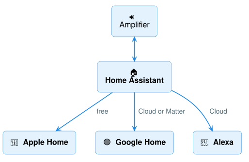
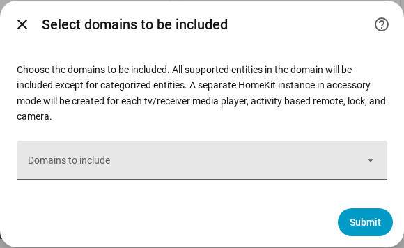

# Apple Home, Google Home & Alexa

Audio Control's zones are ordinary Home Assistant media players, so Home Assistant can
share them with **Apple Home**, **Google Home** and **Alexa** — "Hey Siri, turn on the
Kitchen", "Hey Google, set the Patio to Radio". Nothing extra to install for Audio
Control; you only switch on Home Assistant's own connection to each service.

!!! tip "Rename your zones first"
    Apple, Google and Alexa use the zone and source names — and you say them out
    loud. Give them real names first ([Names & settings](configuration.md)), for
    example *Kitchen* and *Radio*, instead of *Zone 1* and *Source 1*.

## Apple Home (Siri)

Home Assistant's built-in **HomeKit Bridge** shares the zones over your home network.
It is free and needs no account.

1. **Settings → Devices & services → Add integration**, search **HomeKit Bridge**,
   and click **OK**.
2. In **Domains to include**, choose **Media player** only, then **Submit**.

    { width="480" }

3. Home Assistant creates **one HomeKit accessory per zone** and puts a **pairing code
   with a QR code** for each in **Notifications** (bottom left).
4. On your iPhone or iPad: **Home app → + → Add Accessory**, scan a zone's QR code,
   and follow the steps. Repeat for each zone.

Each zone appears as a TV-style tile:

| In the Home app | Works |
|---|---|
| Turn the zone on/off | ✅ |
| Choose the source (input) — by name | ✅ |
| Volume up/down and mute | ✅ with the **Remote** in Control Center (choose the zone), or the iPhone's volume buttons while the Remote is open |
| A volume slider | ❌ Apple doesn't offer one for TV-style accessories |

!!! note "Why one pairing per zone?"
    Apple only allows one TV-style accessory per pairing, so Home Assistant gives each
    zone its own. HomeKit also creates an empty "HASS Bridge" when only media players
    are chosen — you can delete it in **Settings → Devices & services → HomeKit
    Bridge**.

## Google Home and Alexa

The easiest way is **Home Assistant Cloud** (Nabu Casa — a paid subscription that also
funds Home Assistant's development): **Settings → Home Assistant Cloud**, sign in, then
turn on **Google Assistant** and/or **Alexa** and link them in the Google Home or Alexa
app. Under **Settings → Voice assistants → Expose**, make sure your zones are switched on.

You can expect to turn zones on and off, set the volume, mute, and choose the source
by voice. Both can also be connected without a subscription, but it takes a developer
account and some technical setup — see Home Assistant's guides for
[Google Assistant](https://www.home-assistant.io/integrations/google_assistant/) and
[Alexa](https://www.home-assistant.io/integrations/alexa/).

!!! info "Tested so far"
    Apple Home: checked on a real Home Assistant with Audio Control — what Apple
    receives per zone (power, every source by name, volume and mute). Google Home and
    Alexa: based on Home Assistant's documentation, not yet tested with Audio Control.
    [Tell us](https://github.com/mcjelcom/ha-audio-control/issues) how it works for you.

### Alexa: name your sources so Alexa can pick them

Alexa only knows a fixed list of input names. A source called *Spotify* or *Source 3*
is hidden from Alexa; one called **TV**, **CD**, **Tuner**, **Phono**, **Aux 1**,
**HDMI 1** or **Input 3** can be chosen ("Alexa, set Kitchen input to Tuner"). Rename
your sources in [Names & settings](configuration.md) if you want Alexa to switch them.
Then, in the Alexa app, run **Devices → Discover devices** again so Alexa learns the new inputs.

??? info "All names Alexa accepts"
    AUX 1–7, BLURAY, CABLE, CD, COAX 1–2, COMPOSITE 1, DVD, GAME, HD RADIO, HDMI 1–10,
    HDMI ARC, INPUT 1–10, IPOD, LINE 1–7, MEDIA PLAYER, OPTICAL 1–2, PHONO,
    PLAYSTATION (3, 4), SATELLITE, SMARTCAST, TUNER, TV, USB DAC, VIDEO 1–3, XBOX.

Volume and mute work **by voice** ("Alexa, set Kitchen volume to 6", "Alexa, mute
Kitchen"); the Alexa app shows only power and input for these devices. You don't need
an Echo to try it: tap the Alexa button in the app and speak.

!!! info "Tested"
    With Home Assistant Cloud and the Alexa app: discovery and turning a zone on. With the
    Alexa Smart Home messages themselves (what Alexa sends to Home Assistant): on, set
    volume, change volume, mute, unmute, choose an input, off — all reached the amplifier.

## Matter

Google Home, Alexa, SmartThings and Aqara can also reach your zones over **Matter** —
locally and without a subscription, but with fewer controls (on/off and volume). See
[Matter (partial)](matter.md).
