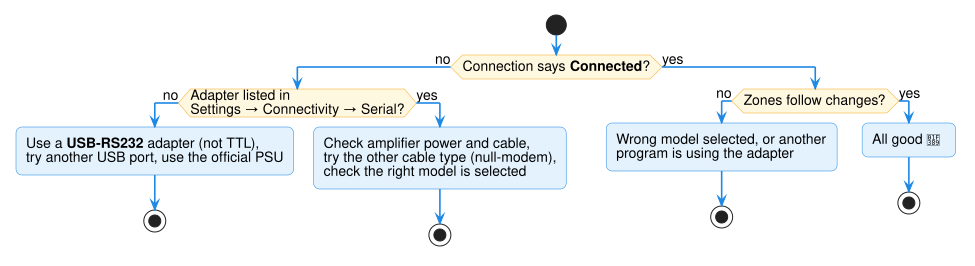

# Help and troubleshooting

## Quick checks



1. Amplifier **switched on**?
2. Cable **pushed in firmly** at both ends?
3. **Right model** picked in the *Device* list?
4. **USB-to-RS232** adapter (not "TTL")?
5. Home Assistant **restarted** after installing Audio Control?

## Common problems

### Connection shows *Disconnected*

- Do the quick checks.
- Try the other cable type: add or remove a **null-modem adapter**. The AMC X86i needs
  **straight-through**.
- Replug the USB adapter and restart Home Assistant.

### The adapter isn't listed

If it's not in **Settings → Connectivity → Serial**:

- Try another USB port on the Raspberry Pi.
- Check it's **USB-to-RS232**; "USB-to-TTL" won't work.
- Cheap unbranded adapters sometimes fail; **FTDI** chips are safe.
- For Docker installs, see [Docker / Container installs](advanced/docker.md).

### It worked, but stopped after a restart

`/dev/ttyUSB0` can change on restart. Use the long **`/dev/serial/by-id/...`** name
([Change the connection](configuration.md#change-the-connection)).

### Zones never change, or show the wrong state

- The wrong model might be selected: check the *Device* name on the amplifier's page.
- Another program might be using the adapter.

### A button or control is missing (e.g. no bass)

Audio Control shows only controls your amplifier has.

### "Zone is off" or "Tone level not supported"

The amplifier refused the command. Turn the zone on, or use a level from the message.

### The Raspberry Pi keeps losing its connection

Use the **official power supply**; weak ones cause random USB and Wi-Fi problems.
Ethernet beats Wi-Fi.

## Still stuck?

Open an [issue on GitHub](https://github.com/mcjelcom/ha-audio-control/issues) with:

1. Your **amplifier model**.
2. The **diagnostics file** (amplifier's page → **Download diagnostics**; connection
   details and passwords are removed automatically).
3. If you can, a **debug log**:

    ??? note "How to turn on debug logging"
        1. Go to **Settings → Devices & services → Audio Control → ⋮ → Enable debug
           logging**.
        2. Repeat the problem.
        3. Click **Disable debug logging** to download the log file.

        Or add this to `configuration.yaml`:

        ```yaml
        logger:
          logs:
            custom_components.audio_control: debug
        ```
