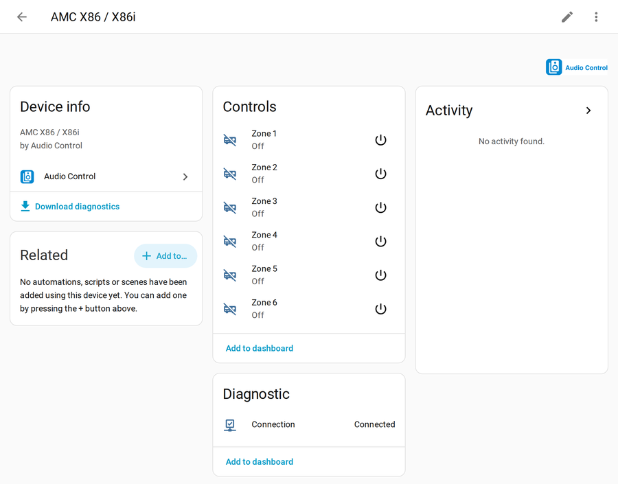
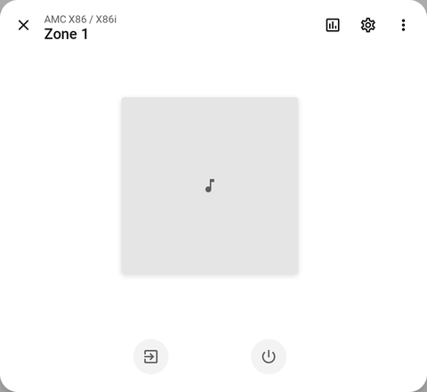
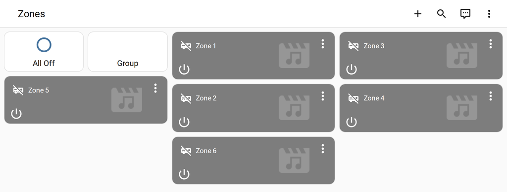
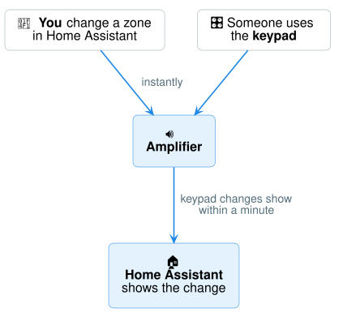

# Using your zones

Every zone of your amplifier is its own **player** in Home Assistant — just like a smart
speaker. You can use it on dashboards, from the Home Assistant phone app, with voice
assistants, and in automations.

## Your amplifier's page

**Settings → Devices & services → Audio Control →** your amplifier.

- **Controls** — every zone, with a power button.
- **Diagnostic → Connection** — shows **Connected** when Home Assistant can talk to the
  amplifier. If it says *Disconnected*, see [Help](troubleshooting.md).

## Control a zone

Click a zone to open its controls — power, volume, mute and source.

{ width="420" }

## Put zones on a dashboard

On the device page, click **Add to dashboard** under *Controls*, or edit any dashboard
and add a **Media control** or **Tile** card for each zone.

## Good to know

- **Changes made on the amplifier** (its keypads, remote or front panel) show up in Home
  Assistant too — at the latest within a minute.
- **Volume** uses Home Assistant's normal 0–100 % slider, whatever scale your amplifier
  uses internally.
- **Bass, treble, "all zones off" and group mode** are in
  [Automations & extra controls](services.md).
